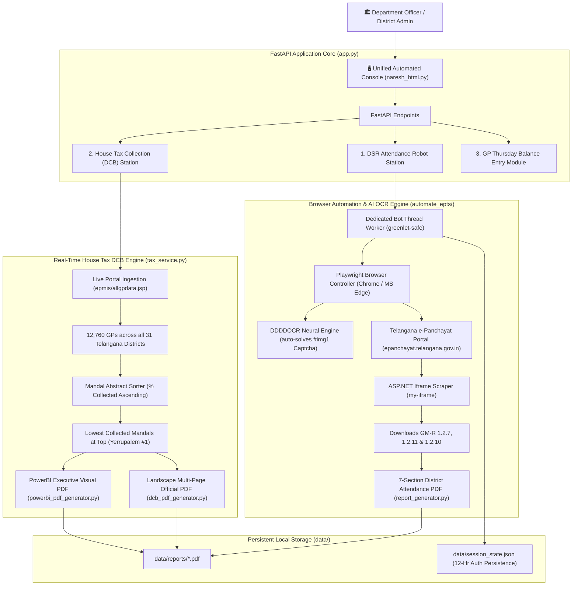

# Telangana e-Panchayat Automated Console (PRKMM)
### Panchayat Raj & Rural Development Department, Government of Telangana

A comprehensive, production-grade automated intelligence and reporting portal for Telangana Gram Panchayats. Built with **FastAPI**, **Playwright headless browser automation**, **DDDDOCR deep learning neural network**, **Pandas**, **ReportLab**, and **PyPDF**.

---

## 🏛️ System Architecture & Core Modules

The platform unites three core government reporting workflows into a single unified console:



---

## ⚡ Key Modules & Capabilities

### 1. DSR & Attendance Robot Station (`automate_epts/`)
* **AI CAPTCHA Solving**: Automatically extracts the `#img1` challenge image from the e-Panchayat login modal, evaluates it via the `ddddocr` ONNX neural model, and types the solution in milliseconds with up to 5 auto-retries.
* **OTP Authentication**: Coordinates login for authorized Department Officer, triggers the 6-digit SMS OTP, verifies it, and persists the browser session across restarts.
* **Frame-Aware Portal Automation**: Traverses ASP.NET iframes (`my-iframe` / `PSPerformance`), expands `DSR REPORTS`, unlocks `readonly` calendar date fields, and extracts:
  * **GM-R 1.2.7**: Attendance Status & DSR Raw Data
  * **GM-R 1.2.11**: Presentees Data of Panchayat Secretaries
  * **GM-R 1.2.10**: Absentees Data of Panchayat Secretaries
* **Official 7-Section PDF Generator**:
  1. District Attendance Abstract (Total GPs, Submitted, Attendance Before 9 AM %)
  2. Mandal-wise Attendance Abstract
  3. GPs with Attendance Pending (Secretary Name, Nature of Posting, Mobile Phone)
  4. GPs with Attendance Marked After 9 AM
  5. Mandal-wise DSR Submission Abstract (Ranked by pending count)
  6. GPs with DSR Entry Pending (Secretary Name & Phone for follow-up)
  7. Absent Secretaries List with leave/deputation remarks

### 2. House Tax Collection (DCB) Analytics Station (`tax_service.py`)
* **100% Live Portal Data**: Fetches real-time Demand, Collection, and Balance (DCB) directly from `https://epanchayat.telangana.gov.in/epmis/allgpdata.jsp`.
* **Zero Stale Files**: No offline or pre-saved Excel files are used; every analysis reflects live government portal records across **12,760 GPs and 31 Districts**.
* **Strict Ranking Rule**: On both the Web Console and the Official Landscape PDF, Page 1 displays the Mandal Abstract **sorted ascending by % Collected** (lowest collection on top):
  * **Rank 1**: Yerrupalem (Lowest % collected)
  * ...
  * **Rank 20**: Penuballi (Highest % collected)
* **Dual PDF Export**:
  * **Official Landscape DCB Report**: Page 1 Mandal Abstract + Mandals & GP details with running page numbers (`Page X of Y`).
  * **PowerBI Executive Visual Report**: Visual analytics charts with color-coded performance bars.

### 3. Thursday GP Balance Entry Module (`GPBALNCE/`)
* Scrapes and compiles weekly Gram Panchayat balance entries across 6 major bank accounts:
  1. GP PD Account (General Fund, 15th FC, SFC - IFMIS)
  2. State Matching Grant (TG-bPASS Account)
  3. 15th Finance Commission Grant - Tied (e-Gram Swaraj)
  4. 15th Finance Commission Grant - Untied (e-Gram Swaraj)
  5. Village Water and Sanitation Committee (VWSC / SBM)
  6. MGNREGS (Material Component)
* Automatically cross-references non-entered Gram Panchayats with secretary phone numbers for follow-up calls.

---

## 🛠️ API Reference

### Department Authentication & DSR Automation (`/api/naresh/*`)
| Method | Endpoint | Description |
|---|---|---|
| `POST` | `/api/naresh/login` | Connects browser bot, solves Captcha with AI OCR, triggers OTP |
| `POST` | `/api/naresh/verify-otp` | Validates 6-digit OTP and authenticates officer session |
| `GET`  | `/api/naresh/session-status`| Returns live background browser engine status & authenticated officer |
| `POST` | `/api/naresh/logout` | Cleans up session state and disconnects browser bot |
| `POST` | `/api/naresh/generate` | Executes live download of GM-R 1.2.7, 1.2.11, 1.2.10 and generates PDF |
| `GET`  | `/api/naresh/view` | Streams latest official 7-section DSR PDF for in-browser viewing |
| `GET`  | `/api/naresh/download` | Downloads latest official DSR PDF |

### House Tax Collection (DCB) Analytics (`/api/tax/*`)
| Method | Endpoint | Description |
|---|---|---|
| `GET`  | `/api/tax/districts` | Returns all 31 Telangana districts with totals and GP counts |
| `GET`  | `/api/tax/mandals` | Returns list of mandals for selected district (`?district=<DistrictName>`) |
| `GET`  | `/api/tax/data` | Returns live DCB summary, sorted mandal abstract, and GP records |
| `GET`  | `/api/tax/report.pdf` | Streams official Landscape multi-page House Tax DCB PDF |
| `GET`  | `/api/tax/powerbi-report.pdf` | Streams executive PowerBI visualization PDF report |
| `GET`  | `/api/tax/download` | Exports consolidated Excel spreadsheet for the district |
| `POST` | `/api/tax/refresh` | Forces live re-download directly from e-Panchayat portal |

### Thursday GP Balance Entry (`/api/balance/*`)
| Method | Endpoint | Description |
|---|---|---|
| `GET`  | `/api/balance/data` | Returns Thursday balance entry summary and pending GP list |
| `GET`  | `/api/balance/view-pdf` | Streams official GP Balance Entry PDF |
| `GET`  | `/api/balance/download-pdf`| Downloads GP Balance Entry PDF |
| `GET`  | `/api/balance/download-excel`| Downloads GP Balance Entry Excel workbook |

---

## 💻 How to Run Locally

### Option 1: 1-Click Desktop Launcher
Double-click `Start_ePanchayat_Server.bat` on your Desktop.

### Option 2: PowerShell (Developer Mode)
```powershell
cd /d "e:\Google Antigravity\EPT_AUTOMATION"
.\.venv\Scripts\Activate.ps1
uvicorn app:app --host 127.0.0.1 --port 8000
```
Open your browser to: `http://127.0.0.1:8000/`

---

## 🛡️ License & Confidentiality
Designed and developed for the **Panchayat Raj & Rural Development Department, Government of Telangana**. All rights reserved.
